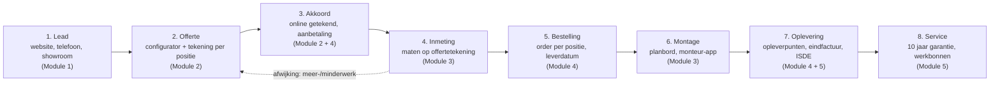
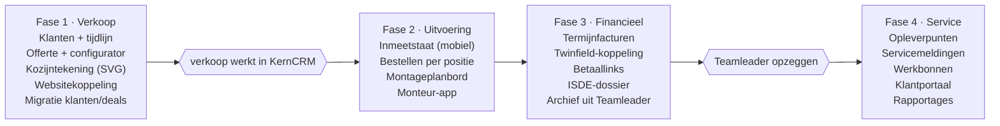

# KernCRM — Functioneel ontwerp

Bijgewerkt 5 nov 2026 · @Michael van Oostveen

## Samenvatting en doel

KernCRM vervangt Teamleader door één systeem dat het hele kozijntraject dekt: van lead en offerte met kozijntekeningen tot inmeting, bestelling, montage, factuur en service. Het grootste knelpunt nu is dat kozijntekeningen buiten Teamleader worden samengesteld en met de hand in de offerte belanden.

**Wat we van Teamleader willen behouden**

- Een overzichtelijk klantbestand (personen en bedrijven) met één tijdlijn per klant
- Een prettige offertemodule met nette PDF en online akkoord
- Tracking van klantactiviteit: offerte geopend, bekeken, ondertekend, mails en belletjes
- Taken, herinneringen en een pijplijn per verkoper

**Wat er nu ontbreekt en KernCRM wel doet**

- Een kozijnconfigurator in het CRM, met dezelfde logica als de configurator op [kernkozijnen.nl](https://www.kernkozijnen.nl/configurator/): profielsysteem, product, maat, glas, kleur, en daarbij per offerteregel een automatisch gemaakte maattekening
- Doorlopende stappen na akkoord: inmeting, definitieve maten, bestelling bij leverancier of werkplaats, montageplanning
- Facturatie in termijnen en een ISDE-subsidiedossier
- Service na oplevering: opleverpunten, werkbonnen en garantie (10 jaar)

**Doel:** geen dubbel werk meer tussen tekenen en offreren, één dossier per klant van eerste contact tot garantie, en zicht op waar elk project staat.

## Procesoverzicht

De klantreis telt acht stappen, en elke kozijnpositie die in de offerte wordt getekend, loopt ongewijzigd door tot en met service.



Wijkt de inmeting af van de offerte, dan gaat het project terug naar de offerte voor een meer- of minderwerkregel die de klant opnieuw akkoord geeft.

## Startscherm (besluit 2026-11-05)

Na het inloggen komt iedereen op een startscherm met drie blokken: **Vraagt aandacht**, de **pijplijn per fase** en **Onlangs**. Het toont per project de laatste offerte; een verkoper ziet standaard de eigen projecten, directie en kantoor alle projecten, en iedereen kan wisselen. De acties zijn afgeleide regels, geen losse taken: getekend (klaar voor inmeting), verlopen, verloopt binnen 3 dagen, warm (de klant heeft de offerte de afgelopen 3 dagen bekeken), na 3 dagen nog niet geopend, een week geen reactie, en een concept dat een week openstaat. Per project telt alleen de belangrijkste actie. Taken, leads van de website en de planning komen op dit scherm zodra die onderdelen er zijn.

## Module 1: Klantbestand en activiteit

Elke klant krijgt één dossier waarin alle contactmomenten, offertes, projecten en servicemeldingen op een tijdlijn staan, net als in Teamleader.

**Klantbestand**

- Personen en bedrijven (particulier, VvE, aannemer, woningcorporatie), met meerdere adressen: factuuradres en een of meer projectadressen
- Velden die kozijnspecifiek zijn: bouwjaar woning, type woning, bereikbaarheid (steiger/hoogwerker nodig), monumentstatus, gewenste periode
- Herkomst van de lead: website-configurator, offerteaanvraag, telefoon, showroom, doorverwijzing, campagne
- Postcodecheck: valt het adres binnen het montagegebied (hergebruik van de website-postcodecheck)
- Dubbele klanten herkennen op e-mail, telefoon en postcode + huisnummer

**Activiteit en tracking**

- Tijdlijn per klant: notities, gesprekken, mails (in- en uitgaand via koppeling met de mailbox), afspraken, statuswijzigingen
- Offertetracking: verstuurd, geopend (hoe vaak, wanneer), welke pagina's bekeken, akkoord of afgewezen, met melding aan de verkoper
- Websiteactiviteit: een configuratie op kernkozijnen.nl komt als lead binnen, met de gekozen kozijnen al ingevuld
- Taken en herinneringen (bijv. "nabellen 3 dagen na versturen offerte"), automatisch aan te maken per fase
- Verkooppijplijn per verkoper: Lead → Offerte → Akkoord / Verloren (de inmeting volgt ná het akkoord, zie Module 3), met reden van verlies

**Communicatie**

- Mailsjablonen met variabelen (naam, offertenummer, inmeetdatum)
- SMS of WhatsApp-herinnering voor inmeet- en montageafspraken (optioneel, via een externe dienst)

## Module 2: Offertemodule met kozijnconfigurator

Dit is het hart van KernCRM: de verkoper stelt elk kozijn in het CRM samen, het systeem tekent het en rekent de prijs, en de offerte wordt daar direct uit opgebouwd.

**Configurator per offerteregel**

1. Profielsysteem kiezen: Schüco LivIng of Aluplast Ideal 7000 NL
2. Product: vast raam, draai-kiepraam, kozijn met meerdere vakken, voordeur, achterdeur, schuifpui, Keralit gevelbekleding
3. Buitenmaten (b × h in mm) en vakverdeling: verticale en horizontale stijlen, bovenlicht, borstwering
4. Per vak: vast, draai-kiep, draai, kiep, met draairichting (links/rechts, binnen/buiten)
5. Glas: HR++, triple, geluidwerend, veiligheidsglas, matglas, met Ug-waarde
6. Kleur binnen en buiten (RAL/folie), kleur van de draaidelen apart
7. Opties: ventilatierooster, horren, roeden, beslag, SKG-sloten, vensterbanken, afwerking binnen en buiten
8. Montage: demontage oud kozijn, afvoer, steiger/hoogwerker, kitwerk

**Tekening**

- Een automatische vooraanzicht-tekening (SVG) met maatlijnen, vakverdeling, draairichtingssymbolen en kleuraanduiding
- Per offerteregel een positienummer (bijv. "Pos. 3 – Woonkamer voorgevel") en eventueel een foto van de bestaande situatie
- Dezelfde tekening wordt later hergebruikt op de inmeetstaat, de bestelling en de werkbon

**Prijsberekening**

- De prijslogica van de website-configurator wordt overgenomen (bron: configurator/index.html in de KernKozijnen-map), maar als beheerbare tabellen in het CRM in plaats van vaste waarden in de code
- Inkoopprijs, marge en verkoopprijs per regel; marge alleen zichtbaar voor verkoop en directie
- Kortingen op het totaal van de offerte, met de grens uit de rollen (verkoop maximaal 10%, directie onbeperkt)
- **Handmatige prijsaanpassing (besluit 2026-11-05):** per gebruiker is een toestemming "mag prijzen handmatig aanpassen" in te stellen door de directie. Wie die toestemming heeft kan de prijs van een positie of artikelregel overschrijven en een eigen totaalprijs invullen. Elke aanpassing heeft een verplichte reden en wordt vastgelegd in een logboek (`prijsaanpassingen`) met de oorspronkelijke prijs, de nieuwe prijs, wie en wanneer. **De reden is vertrouwelijk (besluit 2026-11-05):** alleen de directie kan het logboek lezen, ook via de database; de reden staat nooit op de offerteregel. Het scherm heeft een **tafelmodus** die alle interne informatie verbergt (aanpassingen, oorspronkelijke prijzen, redenen, waarschuwingen, subtotaal bij een eigen totaalprijs), zodat het scherm aan de klant getoond kan worden. In de online offerte, de PDF en de mail aan de klant staan alleen de eindprijzen en expliciete kortingsregels; nooit een reden, een oorspronkelijke prijs of de markering "aangepast". Een prijsverlaging telt mee voor de kortinggrens: wie het totaal meer dan 10% onder de berekende prijs brengt, heeft de directie nodig. De toestemming wordt in de database afgedwongen, niet alleen in het scherm
- **Artikelcatalogus:** de 97 artikelen uit Teamleader staan met vaste verkoopprijzen in de catalogus. Zonder toestemming kiest een gebruiker een artikel uit de catalogus met zijn vaste prijs; een artikelregel met een eigen prijs vraagt de toestemming. Artikelen die de configurator al dekt (kozijnen, glas, kleur, beslag) staan inactief in de catalogus
- **Btw (besluit 2026-11-05):** over het orderbedrag excl. btw geldt 21% over 70% en 9% over 30% (materiaal en arbeid). De offerte toont beide btw-bedragen apart. De verdeling is een instelling per bedrijf. KernKozijnen werkt uitsluitend aan renovatie van woningen ouder dan 2 jaar, dus het verlaagde tarief geldt voor alle opdrachten en het CRM doet geen aparte controle. De boekhouder bevestigt de berekening
- ISDE-indicatie per regel (glas met de juiste U-waarde)

De formule per positie, zoals de configurator nu rekent (bedragen incl. btw, all-in):

```latex
\text{prijs} = \big(\text{basis} + \max(0,\ m^2 - m^2_{\text{std}}) \times \text{meerprijs}_{m^2}\big) \times f_{\text{glas}} \times f_{\text{kleur}} \times f_{\text{beslag}} \times f_{\text{indeling}} \times f_{\text{binnen}} \times f_{\text{profiel}}
```

| Product | Basis (Schüco) | Standaardmaat | Meerprijs per m² | Plafond |
| --- | --- | --- | --- | --- |
| Raamkozijn | € 2.100 | 1,20 m² | € 385 | € 3.000 |
| Voordeur | € 4.700 | 2,07 m² | € 510 | € 6.400 |
| Achterdeur | € 3.800 | 1,89 m² | € 475 | € 6.400 |
| Balkondeur | € 3.800 | 2,30 m² | € 465 | € 6.400 |
| Schuifpui | € 6.000 | 6,90 m² | € 440 | € 10.600 |
| Tuindeuren | € 6.400 | 3,50 m² | € 510 | € 10.600 |

Factoren: profiel Aluplast 0,90 (Schüco 1,00) · triple glas 1,25 · kleur 1,00 tot 1,18 per RAL · RC3-beslag 1,10 · houtnerf of kleur binnen 1,15 · indeling per variant (bijv. stolpraam 1,55, 4-delig 2,70), met een demping van 0,80 voor wijzigingen per vak. Boven 75% van het plafond vlakt de prijs af. In het CRM komt daar per positie een inkoopprijs en marge bij, en kan de verkoper de prijs na inmeting overschrijven.

De bestaande Teamleader-artikelcatalogus (97 artikelen in 15 groepen, o.a. Keralit, sloopwerk, steiger, kraan, afwerking en arbeid) wordt de catalogus voor extra regels naast de kozijnposities.

**Offerte**

- Opgebouwd uit secties: inleiding, posities met tekening + specificatie + prijs, totaal, voorwaarden, garantie, planning
- Huisstijl-PDF en een online offertepagina waar de klant kan bekijken, vragen kan stellen en akkoord geeft met een **echte handtekening** (getekend op het scherm). Naam, handtekening, tijdstip, IP-adres en apparaat worden vastgelegd als bewijs en de klant krijgt dat vooraf te zien (AVG: vermelden in het privacybeleid)
- **Versturen en akkoord (besluit 2026-11-05):** bij versturen wordt de offerte vergrendeld (ook in de database: regels, posities en eigen totaalprijs zijn dan niet meer te wijzigen) en krijgt de klant een eigen link met een geheime sleutel van 256 bits, 14 dagen geldig, zonder inloggen. De publieke pagina krijgt alleen de eindprijzen; de database geeft via een beveiligde functie uitsluitend die ene offerte terug. Versturen kan alleen binnen de kortinggrens (daarboven alleen de directie). De directie kan een verstuurde, nog niet getekende offerte intrekken; de oude link werkt dan niet meer. Een getekende offerte is definitief. Het logboek houdt bij: verstuurd, geopend door de klant (niet als een medewerker meekijkt), akkoord en ingetrokken. Bij het akkoord worden naam, handtekening, tijdstip, IP-adres, apparaat en een kopie van de offerte zoals die getekend is bewaard; de klant leest dat vooraf. Tot de Microsoft 365-koppeling er is, kopieert de verkoper de link en de mailtekst. De **PDF in huisstijl** (A4, groene kop, tekeningen als vectoren, voettekst met paginanummers, betaalschema en een akkoordblok) wordt op aanvraag gemaakt van precies dezelfde gegevens als de online offerte, dus nooit met aanpassingen of redenen; na het tekenen staat de handtekening van de klant erin. De klant opent hem via zijn link, de medewerker via het project. **Nieuwe versie (v2, v3, ...):** een verstuurde, nog niet getekende offerte kan door elke medewerker met schrijfrechten een nieuwe versie krijgen: alles (posities, regels, kortingen, aanpassingen met reden, eigen totaalprijs) wordt als concept gekopieerd, de vorige versie vervalt en blijft bewaard en vergrendeld. Wie de oude link opent, ziet dat de offerte is vervangen en kan niet meer tekenen. Catalogusprijzen worden overgenomen zoals ze op de vorige versie stonden. Een getekende offerte is definitief; wijzigingen daarna lopen als meer- of minderwerk (inmeting)
- Opbouw: een offerte is een lijst met regels (positie, artikelregel, kopregel, vrije tekst, tekstblok uit sjabloon, korting) die in volgorde staan. Na versturen is een versie vergrendeld; een wijziging wordt een nieuwe versie
- Versies (v1, v2...) met vergelijking, en varianten (bijv. Schüco tegenover Aluplast)
- Sjablonen per type opdracht: complete woning, alleen voordeur, schuifpui
- Een configuratie van de website wordt als conceptofferte ingeladen, zodat de verkoper niet opnieuw hoeft te beginnen

## Module 3: Inmeting en montageplanning

Na akkoord plant KernCRM de inmeting, legt de definitieve maten vast op de offertetekeningen en plant de montageploeg in zodra de levering bekend is.

**Inmeting (stand 2026-11-05, deel 1)**

- Na het akkoord plant een medewerker de inmeting op de projectpagina: datum en tijd (Nederlandse tijd), inmeter en een notitie. Het project gaat dan naar de fase Inmeting. Per project is er één geplande inmeting tegelijk; annuleren zet het project terug naar Akkoord
- De inmeter ziet alleen zijn eigen inmetingen en krijgt via een beveiligde functie alleen wat hij nodig heeft: adres, telefoon, bereikbaarheid, woninggegevens, de tekening en de offertemaat per positie. **Nooit prijzen.** Hij heeft geen toegang tot de tabellen zelf. In het menu ziet hij alleen Inmeting, en na het inloggen komt hij op zijn overzicht
- Per positie vult hij de **bestelmaat** in (breedte en hoogte, verplicht: dit is de maat waarop het kozijn wordt besteld), plus de binnenmaat en de buitenmaat (dagmaten) en bijzonderheden, zodat alles is vastgelegd. Direct op het scherm staat een melding bij een afwijking van meer dan 5 mm met de offertemaat. Binnen- en buitenmaat zijn niet verplicht. De bestelmaat wordt vergeleken met de offertemaat (de buitenmaat van het kozijn). Afronden kan pas als alle posities een bestelmaat hebben; daarna is de inmeetstaat vergrendeld, ook in de database. Het project blijft na afronden in de fase Inmeting tot kantoor de afwijkingen heeft afgehandeld
- Voor medewerkers toont de projectpagina na afronding per positie de afwijking en een indicatie van het meer- of minderwerk (met de prijsmodule, zonder handmatige aanpassingen). Het vastleggen daarvan als meer- of minderwerk dat de klant opnieuw goedkeurt volgt
- Per project is er één geplande inmeting tegelijk (afgedwongen in de database). De gekozen inmeter moet lid zijn van het eigen bedrijf; verliest hij dat lidmaatschap, dan verliest hij ook de toegang tot de inmeting. De indicatie voor meer- of minderwerk rekent met de huidige prijsregels, niet met de versie van de offerte. Tijdens de inmeting kan de inmeter per positie de indeling, de draairichting per vak, de kleur (ook van de vleugels) en het glas aanpassen, en artikelen uit de catalogus toevoegen. De maat, het beslag en het profiel blijven zoals in de offerte. Hij ziet alleen de meerprijs of minderprijs van zijn eigen voorstellen (incl. btw), geen offerteprijzen, totalen of catalogusprijzen. De meerprijs van een gewijzigde configuratie rekent de server met de prijsmodule; die van een extra artikel komt uit de catalogus. Omdat de database de prijsmodule niet kent, is de opgeslagen prijs van een gewijzigde configuratie niet bindend: kantoor rekent hem bij het verwerken opnieuw uit en ziet een waarschuwing als hij afwijkt. De database dwingt wel af dat product, maat, beslag, binnenafwerking en profiel gelijk blijven, dat een klantakkoord alleen geldt voor het bedrag dat de klant zag, dat het akkoord daarna niet meer te wijzigen of te verwijderen is, dat per inmeting hoogstens 30 extra's worden toegevoegd en dat per positie maar één wijziging wordt goedgekeurd. Een inmeter ziet alleen zijn eigen voorstellen. Wie daarvoor toestemming heeft (dezelfde toestemming per gebruiker als bij offertes; de directie altijd) kan bij een wijziging of extra de berekende meerprijs vervangen door een eigen prijs, met verplichte reden. De klant en het scherm van de inmeter tonen alleen de uiteindelijke prijs; het voorstel, de eigen prijs, de reden en wie het deed staan in een logboek dat alleen de directie kan lezen (projectpagina). De eigen prijs is de prijs waarvoor de klant tekent. Niet-directie mag hooguit 10% onder het voorstel zitten, de directie onbeperkt; het logboek is niet te wijzigen en een inmeting met logboek kan niet worden verwijderd. Het IP-adres en apparaat komen van de server van KernCRM en zijn bewijs, geen waterdichte controle. De klant tekent ter plekke op het scherm van de inmeter (naam, handtekening, tijdstip, IP-adres en apparaat worden vastgelegd); afronden kan pas als er geen voorstellen meer openstaan zonder akkoord. De getekende offerte blijft ongewijzigd (die is vergrendeld, de klant heeft daarvoor getekend). Goedgekeurde wijzigingen en extra's vormen een aanvulling: de projectpagina toont na afronden de definitieve opdracht (per gewijzigde positie wat er verandert, met nieuwe tekening, de extra's en het totaal: getekende offerte + goedgekeurd meerwerk, incl. btw). Bestellen, werkbon en factuur gebruiken de definitieve configuratie; een nieuwe offerteversie is daarvoor niet nodig. Foto's: de inmeter maakt per positie of algemeen foto's met de telefoon (verkleind tot 1600 px, rechtstreeks naar een privé-opslag, hoogstens 60 per inmeting); alleen wie bij de inmeting hoort kan ze zien en alleen zolang de inmeting gepland is toevoegen of verwijderen. Nog niet gebouwd: stelruimte, sponning en borstwering, handtekening van de klant op de inmeetstaat, werken zonder bereik, de agenda met reistijd en de koppeling met Outlook

- Inmeetafspraak plannen in een agenda per inmeter, met route en reistijd vanaf Hengelo
- Mobiele inmeetstaat (tablet of telefoon): per positie de tekening uit de offerte, met velden voor bestelmaat, binnenmaat, buitenmaat, bijzonderheden en foto's (later ook stelruimte, sponning en borstwering)
- Afwijkingen tegenover de offerte worden gemarkeerd; bij een prijsverschil volgt later een meer- of minderwerkregel die de klant opnieuw akkoord geeft (nog niet gebouwd)
- Digitale handtekening van de klant op de inmeetstaat

**Montageplanning**

- Planbord per week met montageploegen (eigen monteurs) en hun capaciteit
- **Stand deel 1 (gebouwd, kantoorzijde):** het menu Montage toont het planbord per week (ploegen onder elkaar, maandag tot en met vrijdag), met een lijst van projecten die nog ingepland moeten worden. Directie en kantoor beheren de ploegen (toevoegen, uit dienst zetten); verkoop kan meekijken. Een montage plan je op de projectpagina, kan alleen bij een getekende offerte waarvan de inmeting is afgerond (de maten zijn dan definitief) en bestaat uit ploeg, eerste montagedag, aantal werkdagen, de leverdatum van de kozijnen (als bekend), steiger of hoogwerker en een notitie. Een ploeg kan niet dubbel worden ingepland (bewaakt in de database), per project loopt hooguit één montage tegelijk en de eerste dag ligt op een werkdag vanaf vandaag. **Voorlopig of definitief:** zonder leverdatum is de montage voorlopig (de ploeg staat gereserveerd); met leverdatum is hij definitief en kan hij starten op of na de eerste dag. Afronden zet het project in de fase Oplevering; annuleren (met reden) zet het terug naar de fase van vóór het plannen. Feestdagen houden we nog niet bij.
- **Koppeling met de facturen:** op de eerste montagedag van een definitieve montage staat de factuur van de 65%-termijn klaar (op het startscherm en bij de facturen), en na afronden de eindfactuur (5%, met het meer- en minderwerk). Er wordt niets automatisch aangemaakt: kantoor drukt zelf op de knop.
- **Monteurs en ploegen (gebouwd):** op het planbord beheren directie en kantoor de monteurs en de ploegen: namen aanpassen, monteurs in een ploeg zetten (hooguit één ploeg tegelijk; een andere ploeg kiezen verhuist hem), in of uit dienst zetten (uit dienst betekent ook uit de ploeg) en een inlogaccount met de rol monteur aan een monteur koppelen. Een knop laadt de startopstelling van KernKozijnen: Frits, Angelo, Johan, Sem, Nykai, Diger en Jeremy in drie ploegen van twee (Jeremy is reserve); dat is alleen een startpunt. Een ploeg met lopende montages gaat niet uit dienst. Ploegen en monteuren zijn ook definitief te verwijderen (met een bevestigingsstap); heeft een ploeg montages of staat een monteur op een werkbon, dan kan dat niet en blijft uit dienst zetten over.
- **Monteur-app (deel 1, gebouwd):** een monteur met een gekoppeld account ziet alleen "Mijn montages": de definitieve montages van zijn ploeg (komend, lopend en de laatste twee weken afgerond) en per montage het adres met route, de telefoon van de klant, de ploegleden, steiger of hoogwerker, de leverdatum, de kozijnen met tekening en maten uit de inmeting (kozijnmaat, binnen- en buitenmaat, opmerkingen) en de extra's. Wat de klant tijdens de inmeting heeft goedgekeurd, staat er al in verwerkt en is gemarkeerd. **Geen prijzen, met één uitzondering:** de monteur heeft geen toegang tot de tabellen, alleen tot een paar beveiligde functies die geen bedragen teruggeven. De uitzondering is meerwerk ter plekke (zie bij de werkbon): daar ziet hij de catalogusprijs van het artikel dat hij voorstelt, omdat de klant het bedrag moet zien voordat hij tekent. Een voorlopige of geannuleerde montage is voor de monteur onzichtbaar. Trekt de directie de rol monteur van een account in, dan vervalt de toegang direct; een montage die langer dan twee weken geleden is afgerond, is voor de monteur niet meer op te vragen; van de kozijngegevens krijgt hij alleen de bekende keuzes (product, maat, glas, kleur, beslag, indeling), nooit vrije velden.
- **Inloggen met een gebruikersnaam (gebouwd):** Supabase Auth werkt altijd met een e-mailadres. Een monteur logt daarom in met alleen zijn gebruikersnaam (bijvoorbeeld "frits"); de app maakt daar intern het plusadres `info+frits@kernkozijnen.nl` van, dat bij dezelfde mailbox als `info@` uitkomt. Het aliasadres staat in de omgevingsvariabele `ALIAS_ADRES` (later een instelling per bedrijf). De account zelf maak je aan in Supabase (Authentication, Add user) met dat plusadres, "Auto Confirm User" aan, en de rol monteur. **Wachtwoord vergeten:** het inlogscherm heeft een pagina "Wachtwoord vergeten"; voor een gebruikersnaam gaat de herstelmail naar kantoor, voor een gewoon e-mailadres naar dat adres. De link opent `/auth/herstel` en daarna het scherm voor een nieuw wachtwoord (minstens 10 tekens). Zodat de link ook werkt als kantoor hem opent, gebruikt de herstelmail van Supabase een aangepaste tekst met `token_hash`. Kantoor opent die link het best in een privévenster en geeft het nieuwe wachtwoord door aan de monteur. De pagina zegt nooit of een account bestaat.
- **Werkbon en oplevering (monteur-app deel 2, gebouwd):** vanuit de montageafspraak start de monteur de montage (kan op of na de startdag, en alleen als de leverdatum bekend is); daarmee ontstaat de werkbon, één per montage. Per kozijn is er een checklist (geplaatst, afgesteld, afgekit, binnen afgewerkt), een opmerking en foto's voor en na (verkleind op de telefoon, rechtstreeks naar een privé-opslag). Verder legt de ploeg uren per monteur per dag vast (in kwartieren; een monteur schrijft zijn eigen uren), schrijft bijzonderheden voor kantoor met de optie "kantoor moet reageren" (bijvoorbeeld mogelijk meerwerk) en meldt opleverpunten, eventueel met foto. **Opleveren:** de klant tekent op het scherm van de monteur (naam, handtekening, tijdstip, IP-adres en apparaat worden vastgelegd). Dat kan pas als elk kozijn is geplaatst; wat nog niet is afgesteld, afgekit of afgewerkt moet als opleverpunt zijn gemeld. Met een open opleverpunt is het een oplevering met voorbehoud. Daarna is de montage afgerond, het project staat in de fase Oplevering en de werkbon is vergrendeld (alleen kantoor kan nog opleverpunten als opgelost markeren). Alleen een monteur (of de directie) levert op; kantoor kan niet namens de klant tekenen en kan een montage ook niet zelf afronden: de oplevering gaat altijd met de handtekening van de klant (is er nog geen werkbon, dan start een monteur hem via de montageafspraak). Na de oplevering zijn ook de checklist, uren, foto's en opleverpunten vergrendeld; kantoor kan een opleverpunt nog wel als opgelost markeren maar niet weer openzetten. Een project met een opgeleverde werkbon (het bewijs voor de garantie van 10 jaar) kan niet worden verwijderd. IP-adres en apparaat bij de oplevering komen van de app en zijn indicatief. Op de projectpagina ziet kantoor de voortgang, de uren per monteur, de bijzonderheden (met een knop "gezien en opgepakt") en de opleverpunten; op het startscherm staan meldingen van monteurs en open opleverpunten; bij de eindfactuur staat een waarschuwing zolang er opleverpunten open staan (kantoor beslist). Een werkbon met handtekening verdwijnt niet met het project. **Meerwerk ter plekke (gebouwd):** vraagt de klant tijdens de montage om extra werk of materiaal, dan kiest de monteur een artikel uit de catalogus (de prijs staat vast, de monteur kan hem niet aanpassen, tot 20 regels per werkbon) en geeft de telefoon aan de klant. De klant ziet het totaal (incl. btw) en tekent (naam, handtekening, tijdstip, IP-adres en apparaat worden vastgelegd; alleen een monteur of de directie legt dat vast, kantoor niet). De klant tekent voor het bedrag dat hij zag; is dat intussen veranderd, dan moet hij opnieuw kijken. Goedgekeurd meerwerk staat vast en telt mee in de opdracht en op de eindfactuur (samen met het meerwerk uit de inmeting); voorstellen zonder akkoord kunnen worden verwijderd en vervallen bij annuleren van de montage. Opleveren kan pas als er geen meerwerk meer openstaat zonder handtekening. Is alles al gefactureerd, dan kan er geen meerwerk meer worden toegevoegd (kantoor lost dat eerst op). Kantoor ziet het meerwerk op de projectpagina en in de werkbon-PDF; verkoop leest mee. **Menu Werkbonnen:** directie, kantoor en verkoop zien bovenaan alle werkbonnen in een overzicht met filters (wordt ingevuld, aandacht nodig, opgeleverd, alle): project, ploeg, montageperiode, status, open opleverpunten en uren. Directie en kantoor openen daar ook de werkbon-PDF (met foto's en handtekening); verkoop ziet alleen het overzicht. Monteurs zien alleen hun eigen montages en inmeters geen werkbonnen.
- **Werkbon als PDF (gebouwd):** directie en kantoor downloaden op de projectpagina (bij Montage, "PDF") de werkbon in huisstijl: klant en adres, ploeg en monteurs, montagedatum, per kozijn de tekening, maten, checklist, opmerkingen en tot drie foto's van na de montage, de extra's, bijzonderheden, opleverpunten (met hooguit zes foto's), de uren per monteur en, na de oplevering, de handtekening van de klant met naam en tijdstip. Zo kan het opleverbewijs naar de klant en blijft het bij het project bewaard. Zonder prijzen. Is de werkbon nog niet opgeleverd, dan staat dat duidelijk bovenaan en is er nog geen handtekening. De foto's van voor de montage staan alleen in het CRM.
- **Nog niet gebouwd:** werken zonder bereik; vastleggen welke monteurs er daadwerkelijk bij een montage waren (de samenstelling is nu de huidige ploeg); capaciteit per ploeg, feestdagen en de koppeling met de agenda.
- Een montageklus koppelt aan het project: posities, tekeningen, benodigd materiaal, steiger/hoogwerker
- Ingeplande montage pas definitief zodra de leverdatum bekend is (doorlooptijd nu circa 6 tot 8 weken)
- Bevestiging en herinnering naar de klant per mail of sms, met datum en tijdvak
- Montage-app voor de monteur: werkbon, tekeningen, checklist, foto's voor en na, uren en handtekening bij oplevering

## Module 4: Bestellen en facturatie

Na de inmeting maakt KernCRM met één klik de bestelling aan op basis van de ingemeten posities, en factureert het project in termijnen.

**Bestellen**

- Bestelorder per leverancier: Kozijnbouw Enschede en Eko-Okna (Polen), met per positie de tekening, maten, profiel, glas, kleur en beslag
- Glas en losse materialen (vensterbanken, kit, roosters) als aparte bestelregels
- Status per bestelling: concept → besteld → bevestigd (met leverdatum) → geleverd → gecontroleerd
- Leverdatum stuurt automatisch de montageplanning aan
- Export naar het format van de leverancier (PDF, Excel of een koppeling, afhankelijk van wat de leverancier ondersteunt)

**Facturatie**

- **Termijnschema (besluit 2026-11-05):** 30% bij akkoord, 65% op de eerste dag van de levering en montage van de kozijnen en 5% na oplevering. De percentages zijn instelbaar per bedrijf en per project
- Facturen met een vast nummer, PDF in huisstijl, betaallink (bijv. Mollie of iDEAL) en automatische herinneringen
- **Stand deel 1 (gebouwd):** op de projectpagina staat na het akkoord een blok Facturen met de drie termijnen uit de getekende offerte. Kantoor of directie maakt de factuur van de volgende termijn aan (verkoop kan meelezen). Betaaltermijnen volgens de voorwaarden: aanbetaling (30%) binnen 3 dagen, de 65% op de dag van levering (direct), de eindtermijn (5%) binnen 3 dagen. Het goedgekeurde meer- en minderwerk van de inmeting komt op de eindfactuur. Het btw-bedrag wordt per factuur gesplitst volgens dezelfde regel als de offerte (21% over 70%, 9% over 30%). De database bewaakt dat het totaal van alle facturen het getekende offertebedrag plus het goedgekeurde meerwerk niet overstijgt, dat de termijnen in volgorde lopen en dat het factuurnummer alleen via de factuurfuncties wordt genomen (geen gaten).
- **Factuur aanpassen:** zolang een factuur open staat, kunnen directie en kantoor de omschrijving, de begeleidende tekst en de vervaldatum aanpassen. Het bedrag aanpassen kan alleen met de toestemming "prijzen aanpassen" (de directie altijd), met een verplichte reden, niet onder wat al is betaald en niet boven de opdracht; het btw-bedrag wordt dan opnieuw berekend. Elke wijziging komt met oude en nieuwe waarden, wie en waarom in een logboek dat alleen de directie leest. Nummer, termijn, factuurdatum en de klantgegevens (zoals ze waren bij het aanmaken) liggen vast. Een betaalde of geannuleerde factuur is definitief; een open factuur met deelbetaling kan nog wel worden aangepast. Een factuur verdwijnt nooit (fiscale bewaarplicht, ook niet met het project of het bedrijf); bij een fout annuleer je hem met een reden (het nummer blijft bestaan) en maak je een nieuwe. Een formele creditnota is er nog niet: voor een al verstuurde factuur is dat de nette route, zodra de boekhoudkoppeling er is.
- **Facturenoverzicht** (menu Facturen, voor directie, kantoor en verkoop): alle facturen met filters (open, te laat, nog niet verzonden, betaald, alle) en bovenaan het openstaande bedrag, het te late bedrag, het gefactureerde en het ontvangen bedrag. Op het startscherm staan voor directie en kantoor de facturen die te laat zijn of nog niet naar de klant zijn gestuurd.
- **Verzenden en herinneren (zonder mailkoppeling):** per factuur staat een kant-en-klare mailtekst (onderwerp en tekst, passend bij de termijn) om te kopiëren; de PDF voeg je zelf toe. Daarna leg je vast dat hij is verzonden (eenmalig, staat vast). Is een verzonden factuur over de vervaldatum, dan zet het systeem de eerste herinnering klaar; er zijn drie niveaus (vriendelijk, tweede, laatste), met minstens 7 dagen ertussen, en elk verstuurd niveau wordt vastgelegd. De teksten blijven beleefd en noemen geen incasso of juridische stappen. Met de mailkoppeling (aansluiting per bedrijf, zie Koppelingen) gaat dit straks automatisch vanuit het CRM.
- **Factuurpagina en betalingen:** elke factuur heeft een eigen pagina (`/facturen/[id]`) met de gegevens, de PDF, de betalingen, de herinneringen en de mailteksten. Directie en kantoor registreren daar een betaling als *volledig betaald* (het openstaande bedrag) of als *gedeeltelijke betaling* (eigen bedrag en datum); een betaling staat vast en kan niet worden gewijzigd. Per betaling staat een kant-en-klare **betaalontvangstbevestiging** (volledig voldaan, of deelbetaling met het resterende bedrag en de vervaldatum) die met één klik in het mailprogramma opent (adres van de klant al ingevuld; de PDF is niet nodig). Daarna leg je vast dat de bevestiging is verstuurd (eenmalig, staat vast). Herinneringen werken vanaf dezelfde pagina volgens de regels hierboven.
- Betalingen registreer je handmatig; is het volle bedrag binnen, dan staat de factuur op betaald. De PDF staat in huisstijl met vriendelijke begeleidende tekst per termijn. IBAN, KvK- en btw-nummer staan nog als herkenbare lege plekken tot ze zijn ingevuld.
- **Creditnota's (gebouwd):** een verzonden, nog openstaande factuur corrigeer je met een creditnota, geheel of gedeeltelijk, vanaf de factuurpagina. Dat kan alleen met de toestemming "prijzen aanpassen" (directie altijd); de reden komt in het logboek van de directie en niet op de creditnota. Een creditnota heeft een eigen nummer (CN-jaar-volgnummer), een eigen PDF in huisstijl (bedragen als aftrek, verwijzing naar de factuur), staat vast en verdwijnt nooit; je kunt niet meer crediteren dan er nog openstaat. De factuur onthoudt het gecrediteerde bedrag: wat nog te betalen is, is het factuurbedrag min betalingen min creditnota's. Is alles gecrediteerd, dan krijgt de factuur de status *gecrediteerd* en kan de termijn opnieuw worden gefactureerd; een gecrediteerde factuur telt niet meer mee voor het plafond van de opdracht. Een factuur met een creditnota kan niet meer worden aangepast of geannuleerd. De mailtekst voor de klant staat klaar en je legt vast dat de creditnota is verstuurd. Nog niet: terugbetalen van een al betaalde factuur (creditnota op een betaald bedrag) en het doorgeven aan Twinfield.
- **Nog niet gebouwd:** automatisch versturen vanuit het CRM, betaallink, automatische herinneringen, Twinfield-koppeling en automatisch aanmaken bij levering/oplevering (wacht op montageplanning)
- Meer- en minderwerk uit inmeting of montage komt automatisch op de eindfactuur
- **Betaallinks, voorbereiding (gebouwd):** per factuur kan er één actieve betaallink zijn (online betalen, bijvoorbeeld iDEAL via Mollie). Tot de verbinding met de betaaldienst er is, maakt kantoor de link zelf in het dashboard van de betaaldienst en legt hem op de factuurpagina vast (alleen https, eventueel met geldigheidsdatum; een nieuwe link trekt de vorige in). De link staat dan in de mailtekst van de factuur en van herinneringen en op de PDF. Dat de klant heeft betaald, registreer je zoals altijd als betaling; de link volgt de factuur: een betaling die de factuur helemaal betaalt zet hem op betaald, een deelbetaling of creditnota trekt hem in (het bedrag klopt dan niet meer) en een geannuleerde of gecrediteerde factuur laat hem verlopen. De betaaldienst (nu Mollie of geen, met optioneel profiel-id; geen geheimen) stel je in bij Boekhouding. In de code praat het CRM alleen met een eigen contract (`BetaalProvider`: betaling aanmaken, status opvragen). Nog niet gebouwd: de verbinding zelf (wacht op een API-sleutel), automatisch een link aanmaken en betalingen automatisch registreren via de melding van de betaaldienst.
- **Boekhouding, voorbereiding (gebouwd):** het menu Boekhouding (directie en kantoor) bevat de aansluiting per bedrijf (pakket Twinfield of geen, aan of uit, met kantoorcode, verkoopdagboek, grootboekrekeningen en btw-codes; geen geheimen: inloggegevens komen later versleuteld per bedrijf), een **export** (CSV, puntkomma-gescheiden, voor Excel) van de verzonden verkoopfacturen en creditnota's of van de ontvangen betalingen over een periode, en een **wachtrij**. Is de aansluiting actief, dan komt elke factuur bij het verzenden en elke creditnota bij het versturen vanzelf in de wachtrij; een knop voegt de al verzonden facturen toe. Tot de echte verbinding er is, boek je met de export en markeer je het onderdeel als verwerkt (met optioneel het boekingsnummer; een verwerkt onderdeel staat vast) of overslaan. Wordt een factuur geannuleerd nadat hij in de wachtrij kwam, dan wordt hij overgeslagen, of krijgt hij (als hij al was geboekt) een waarschuwing om handmatig te corrigeren. In de code praat het CRM alleen met een eigen contract (`BoekhoudProvider`: controleren, boeken, betaalstatus ophalen); een boeking is neutraal van vorm (omzet verdeeld over hoog en laag tarief, creditnota negatief) en een aansluiting vertaalt die naar zijn eigen formaat. Nog niet gebouwd: de verbinding zelf (wacht op toegang tot een Twinfield-account), debiteuren aanmaken en de betaalstatus terugzetten in het CRM.
- Koppeling met Twinfield: verkoopfacturen en debiteuren gaan automatisch naar Twinfield, betaalstatus komt terug; inkoopfacturen van leveranciers blijven via Basecone binnenkomen en worden aan het project gekoppeld voor nacalculatie

**ISDE-subsidie**

- Per project een subsidiedossier: welke posities in aanmerking komen (isolerend glas, panelen, deuren), m² en U-waarden
- Automatisch de stukken die de klant nodig heeft: factuur met specificatie, betaalbewijs, foto's na plaatsing
- Status: niet van toepassing / klaargezet / aangevraagd door klant / toegekend (of afgewezen)
- **Stand (gebouwd, voorbereiding):** op de projectpagina staat het blok ISDE-subsidie (na akkoord op de offerte). Per positie legt directie of kantoor vast of ze meetelt, de U-waarde van het glas (volgens de leverancier) en de m² glas (standaard geschat uit de maten); het blok toont de indicatie per positie en voor het project, de checklist met stukken (factuur, betaalbewijs, foto's na plaatsing, getekende oplevering, glasspecificatie; het systeem ziet zelf wat er al is) en de status met datum van aanvraag en referentie van RVO. Verkoop kan meekijken. De klant vraagt de subsidie zelf aan; de bedragen zijn indicatief en komen uit de prijsregels, de voorwaarden van RVO zijn niet ingebouwd. Nog niet gebouwd: de stukken als één pakket downloaden en de ISDE-begeleiding als artikel op de offerte.

## Module 5: Service, opleverpunten en werkbonnen

Opleverpunten en servicemeldingen hangen aan het project en de positie, zodat elke monteur ziet om welk kozijn het gaat en wat er eerder is gedaan.

**Opleverpunten**

- Bij oplevering legt de monteur punten vast per positie (kras, afstelling, kitwerk), met foto en de handtekening van de klant
- Elk punt krijgt een eigenaar, een prioriteit en een streefdatum; het project is pas "afgerond" als alle punten zijn opgelost
- Een openstaand opleverpunt kan de laatste factuurtermijn tegenhouden (instelbaar)

**Servicemeldingen en garantie**

- Melding door de klant via een webformulier of klantportaal (met foto), of ingevoerd door kantoor
- Garantiecheck automatisch: binnen 10 jaar na oplevering, op materiaal of montage; buiten garantie volgt een prijsopgave
- Doorzetten naar de leverancier als het om een materiaalfout gaat (bijv. glasbreuk of defect beslag)

**Werkbonnen**

- Werkbon per bezoek: wat er moet gebeuren, tekening van de positie, materiaal, uren, foto's en de handtekening van de klant
- Uren en materiaal op een werkbon buiten garantie gaan direct naar een factuur
- Onderhoudsabonnement of periodieke controle als optie (bijv. afstellen en hang- en sluitwerk smeren)

## Datamodel

Het project is de spil: een klant heeft een of meer projecten, en elk project draagt offertes, posities, inmetingen, bestellingen, montages, facturen en servicemeldingen.

| Entiteit | Belangrijkste velden | Hoort bij |
| --- | --- | --- |
| Klant (persoon/bedrijf) | naam, contactgegevens, type, herkomst lead | — |
| Adres | straat, postcode, plaats, soort (factuur/project), montagegebied ja/nee | Klant |
| Project | projectadres, fase, verkoper, verwachte omzet | Klant |
| Offerte | nummer, versie, status, geldig tot, totaal, akkoorddatum | Project |
| Positie (kozijn) | positienummer, ruimte, profielsysteem, product, maten, vakverdeling, glas, kleur, opties, tekening (SVG), prijs | Offerte |
| Inmeting | gepland op, inmeter, status (gepland, uitgevoerd, geannuleerd), notitie; hoort bij de akkoord-offerte | Project |
| Inmetingsregel | bestelmaat, binnenmaat, buitenmaat, bijzonderheden per positie (later foto's, handtekening) | Inmeting + Positie |
| Bestelling | leverancier, status, leverdatum, regels per positie | Project |
| Montage | datum, ploeg, posities, checklist, uren | Project |
| Factuur | nummer, termijn, bedrag, status, betaling | Project |
| Opleverpunt / Servicemelding | positie, omschrijving, foto, status, garantie ja/nee | Project + Positie |
| Werkbon | datum, monteur, werkzaamheden, materiaal, uren | Servicemelding of Montage |
| Activiteit | type (notitie, mail, gesprek, offerte geopend), datum, gebruiker | Klant + Project |
| Taak | omschrijving, eigenaar, deadline, status | Klant + Project |
| Prijsmatrix / Product | profielsysteem, product, maatstaffel, inkoop, verkoop, toeslagen | Catalogus |

De positie is het belangrijkste detail: dezelfde positie loopt van offerte via inmeting en bestelling tot montage en service, zodat de tekening en de maten maar één keer worden ingevoerd.

## Rollen en rechten

Vijf rollen dekken het team; marges en inkoopprijzen zijn alleen zichtbaar voor directie en verkoop.

Het hoofdmenu hangt af van de rol (`lib/menu.ts`): directie ziet alles; verkoop en kantoor zien Start, Klanten, Projecten, Inmeting, Facturen en Catalogus (alleen inzien, de directie beheert); de gebruikers beheert alleen de directie; de inmeter ziet alleen Inmeting; een rol zonder eigen schermen, zoals de monteur tot de montage-app er is, ziet alleen Start. De menukeuze is geen beveiliging: de database (RLS) en de pagina's bewaken de toegang zelf.

| Rol | Ziet | Kan |
| --- | --- | --- |
| Directie / beheer | alles, incl. marges en rapportages | instellingen, prijzen, gebruikers, kortingen zonder grens (de admin is het account info@kernkozijnen.nl) |
| Verkoop | eigen klanten en projecten, marges | leads, offertes, configurator, kortingen tot maximaal 10% van het totaal van de offerte |
| Kantoor / planning | alle klanten en projecten, geen marges | inmeting en montage plannen (verkoop mag een inmeting ook plannen), bestellen, factureren, service |
| Inmeter | alleen toegewezen inmetingen: adres, contact, tekening en offertemaat; nooit prijzen of het klantenbestand | inmeetstaat invullen, foto's, handtekening klant |
| Monteur | eigen werkbonnen en montages | checklists, foto's, uren, opleverpunten, handtekening |

Daarnaast is er een **klantportaal** voor de klant zelf: offerte bekijken en akkoord geven, afspraken zien, documenten downloaden en een servicemelding doen.

## Techniek en architectuur

Voorstel: een webapplicatie op Next.js met een PostgreSQL-database via Supabase, gehost in de EU. Die werkt in de browser en op tablet en telefoon, zonder installatie.

| Onderdeel | Keuze | Waarom |
| --- | --- | --- |
| Frontend + backend | Next.js (React, TypeScript) | één codebase voor kantoor, inmeter, monteur en klantportaal |
| Database | PostgreSQL (Supabase, EU-regio) | relationeel datamodel, rechten per rij, back-ups |
| Login | Supabase Auth, met tweestapsverificatie | rollen en rechten per gebruiker |
| Bestanden | Supabase Storage | foto's, tekeningen, PDF's, getekende documenten |
| Kozijntekening | eigen SVG-tekenmodule | dezelfde logica als de website-configurator, herbruikbaar op offerte, inmeetstaat en werkbon |
| PDF | server-side rendering van HTML naar PDF | offertes, facturen, werkbonnen in huisstijl |
| Mobiel | progressive web app, werkt ook offline | inmeters en monteurs zonder goed bereik |
| Hosting | Vercel of een EU-VPS | automatische updates, schaalt mee |

**Koppelingen**

- Website-configurator kernkozijnen.nl → lead + conceptofferte (API-endpoint)
- Outlook / Microsoft 365 via Microsoft Graph: in- en uitgaande mail op de klanttijdlijn, versturen vanuit het CRM, en inmeet- en montageafspraken in de Outlook-agenda
- **Mail en agenda zijn een aansluiting per bedrijf, geen vaste keuze (besluit 2026-11-05).** KernKozijnen gebruikt Office 365, maar KernCRM wordt verkocht aan andere kozijnbedrijven die Google Workspace of een gewone mailserver gebruiken. De code praat daarom niet rechtstreeks met Microsoft maar met een eigen, kleine aansluiting (`MailProvider` en `AgendaProvider`: mail versturen, mail ophalen voor de klanttijdlijn, afspraak aanmaken en bijwerken). Per bedrijf kies je in de instellingen welke aansluiting actief is en vul je de gegevens in: **Microsoft 365** (via Microsoft Graph, OAuth), **Google Workspace** (Gmail- en Calendar-API) of **gewone mailserver** (SMTP voor verzenden, IMAP voor ophalen; zonder agenda). Zo gebruikt elke licentienemer dezelfde code met eigen instellingen en eigen inloggegevens. De inloggegevens en tokens staan per bedrijf versleuteld in de database (Supabase Vault), nooit in de repository en nooit leesbaar voor andere bedrijven. We bouwen eerst Microsoft 365 (nodig voor KernKozijnen) en de SMTP-aansluiting als terugvaloptie; Google volgt zodra een klant erom vraagt. Tot de koppeling er is, kopieert de medewerker de mailtekst (offerte, factuur, herinnering) en voegt de PDF zelf toe.
- Twinfield (verkoopfacturen, debiteuren, betaalstatus); Basecone blijft de ingang voor inkoopfacturen
- Betalingen (bijv. Mollie)
- Digitaal ondertekenen: eigen akkoordflow met handtekening en IP-vastlegging (besluit 2026-11-05)
- SMS/WhatsApp-herinneringen (bijv. via MessageBird of Twilio)

**Privacy en beveiliging:** data in de EU, versleutelde verbindingen, logging van wie wat heeft gewijzigd, en een verwerkersovereenkomst met de hostingpartij (AVG).

**Schaalbaar en verkoopbaar (multi-tenant)**

KernCRM wordt vanaf dag één gebouwd voor meerdere kozijnbedrijven, met KernKozijnen als eerste klant:

- Elk bedrijf is een aparte omgeving (tenant) in dezelfde database, strikt gescheiden via rechten per rij
- Per bedrijf eigen huisstijl op offerte en factuur, eigen nummering, voorwaarden en mailsjablonen
- Productcatalogus en prijslogica per bedrijf: profielsystemen, producten, factoren en marges zijn instellingen, geen code
- Leveranciers en koppelingen (Twinfield, mail en agenda via Microsoft 365, Google of gewone mailserver, betaaldienst) per bedrijf in te stellen
- Abonnementsbeheer en onboarding voor nieuwe klanten, en een import vanuit Teamleader als standaard migratiepad

Dat kost in fase 1 iets meer werk, maar achteraf ombouwen naar multi-tenant is veel duurder.

## Migratie vanuit Teamleader

Alle gegevens gaan mee via de Teamleader Focus API (met een eenmalige koppeling op jullie account), aangevuld met CSV-exports waar de API iets niet levert.

| Teamleader | Wordt in KernCRM | Aanpak |
| --- | --- | --- |
| Contacten en bedrijven | Klanten + adressen | volledig, met tags en eigen velden; ontdubbelen bij import |
| Deals + fases | Projecten + pijplijnfase | fases worden gekoppeld aan de nieuwe pijplijn |
| Offertes | Offertes (archief) | metadata + bedrag als gegevens, de originele PDF als bijlage; geen herbouw naar posities |
| Facturen + betalingen | Facturen (archief) | gegevens + PDF; de boekhouding blijft leidend |
| Notities, taken, gesprekken, afspraken | Activiteiten op de tijdlijn | met datum en gebruiker |
| Bestanden | Bijlagen bij klant/project | gedownload en opnieuw opgeslagen |
| Producten / prijslijst | Catalogus | de bestaande artikelcatalogus (97 artikelen, CSV in de map teamleader/) gaat 1-op-1 mee; inkoopprijzen worden later handmatig ingevoerd |

**Stappenplan**

1. Proefmigratie naar een testomgeving en een controle samen met jullie (aantallen, steekproeven)
2. Bevriesmoment: Teamleader alleen nog lezen
3. Definitieve migratie en controle
4. Teamleader nog een periode als archief aanhouden, daarna opzeggen

## Fasering

We bouwen in vier fases en beginnen bij verkoop, omdat daar het knelpunt zit; Teamleader blijft tot en met fase 3 alleen in gebruik voor facturatie.



Elke fase wordt afgesloten met een testperiode met echte projecten. De duur per fase spreken we af zodra de open vragen hieronder beantwoord zijn.

## Open vragen en beslispunten

**Beantwoord**

- [x] Prijsopbouw: overnemen uit de website-configurator en de Teamleader-artikelcatalogus (zie Module 2)
- [x] Doelgroep: eerst KernKozijnen, maar schaalbaar en verkoopbaar aan andere kozijnbedrijven (multi-tenant)
- [x] Leveranciers: Kozijnbouw Enschede en Eko-Okna (Polen)
- [x] Boekhouding: Twinfield, met Basecone voor inkoopfacturen
- [x] Mail en agenda: aansluiting per bedrijf (Microsoft 365 eerst, met SMTP als terugval, Google later) zodat de code voor elke klant dezelfde is. De koppeling wordt later ingeregeld; tot dan kopieert de gebruiker de mailtekst en de link en markeert de offerte als verstuurd
- [x] Btw: 21% over 70% en 9% over 30% van het orderbedrag excl. btw (2026-11-05)
- [x] Termijnschema: 30% bij akkoord, 65% bij eerste leverdag, 5% na oplevering (2026-11-05)
- [x] Korting: maximaal 10% voor gewone gebruikers, onbeperkt voor de admin (2026-11-05)
- [x] Akkoord op een offerte: echte handtekening met IP-registratie (2026-11-05)
- [x] Inkoopprijzen: worden later handmatig ingevoerd in de catalogus; tot die tijd toont het CRM geen marge

**Nog open**

- [ ] Welk profielsysteem komt van welke leverancier (Schüco LivIng en Aluplast Ideal 7000 NL bij Kozijnbouw Enschede of Eko-Okna)?
- [ ] In welk format nemen Kozijnbouw Enschede en Eko-Okna een bestelling aan (PDF, Excel, eigen portaal of tekenpakket)?
- [ ] Hoeveel gebruikers per rol (verkoop, kantoor, inmeters, monteurs)?
- [ ] Moet het klantportaal in fase 1 al mee, of later?
- [ ] Welke rapportages wil de directie zien (omzet per verkoper, conversie, doorlooptijd, openstaande service)?
- [ ] Verkoopmodel naar andere bedrijven: abonnement per gebruiker, per bedrijf, of eenmalige licentie?
