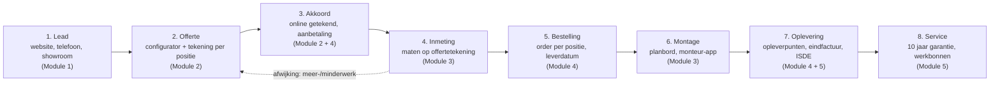
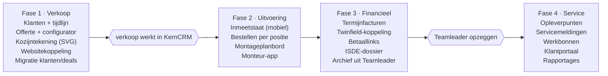

# KernCRM — Functioneel ontwerp

Nov 4, 2026 · @Michael van Oostveen

## Samenvatting en doel

KernCRM vervangt Teamleader door één systeem dat het hele kozijntraject dekt: van lead en offerte met kozijntekeningen tot inmeting, bestelling, montage, factuur en service. Het grootste knelpunt nu is dat kozijntekeningen buiten Teamleader worden samengesteld en met de hand in de offerte belanden.

**Wat we van Teamleader willen behouden**

- Een overzichtelijk klantbestand (personen en bedrijven) met één tijdlijn per klant
- Een prettige offertemodule met nette PDF en online akkoord
- Tracking van klantactiviteit: offerte geopend, bekeken, ondertekend, mails en belletjes
- Taken, herinneringen en een pijplijn per verkoper

**Wat er nu ontbreekt en KernCRM wel doet**

- Een kozijnconfigurator in het CRM, met dezelfde logica als de configurator op [kernkozijnen.nl](https://www.kernkozijnen.nl/configurator/): profielsysteem, product, maat, glas, kleur, en daarbij per offerteregel een automatisch gemaakte maattekening
- Doorlopende stappen na akkoord: inmeting, definitieve maten, bestelling bij leverancier of werkplaats, montageplanning
- Facturatie in termijnen en een ISDE-subsidiedossier
- Service na oplevering: opleverpunten, werkbonnen en garantie (10 jaar)

**Doel:** geen dubbel werk meer tussen tekenen en offreren, één dossier per klant van eerste contact tot garantie, en zicht op waar elk project staat.

## Procesoverzicht

De klantreis telt acht stappen, en elke kozijnpositie die in de offerte wordt getekend, loopt ongewijzigd door tot en met service.



Wijkt de inmeting af van de offerte, dan gaat het project terug naar de offerte voor een meer- of minderwerkregel die de klant opnieuw akkoord geeft.

## Module 1: Klantbestand en activiteit

Elke klant krijgt één dossier waarin alle contactmomenten, offertes, projecten en servicemeldingen op een tijdlijn staan, net als in Teamleader.

**Klantbestand**

- Personen en bedrijven (particulier, VvE, aannemer, woningcorporatie), met meerdere adressen: factuuradres en een of meer projectadressen
- Velden die kozijnspecifiek zijn: bouwjaar woning, type woning, bereikbaarheid (steiger/hoogwerker nodig), monumentstatus, gewenste periode
- Herkomst van de lead: website-configurator, offerteaanvraag, telefoon, showroom, doorverwijzing, campagne
- Postcodecheck: valt het adres binnen het montagegebied (hergebruik van de website-postcodecheck)
- Dubbele klanten herkennen op e-mail, telefoon en postcode + huisnummer

**Activiteit en tracking**

- Tijdlijn per klant: notities, gesprekken, mails (in- en uitgaand via koppeling met de mailbox), afspraken, statuswijzigingen
- Offertetracking: verstuurd, geopend (hoe vaak, wanneer), welke pagina's bekeken, akkoord of afgewezen, met melding aan de verkoper
- Websiteactiviteit: een configuratie op kernkozijnen.nl komt als lead binnen, met de gekozen kozijnen al ingevuld
- Taken en herinneringen (bijv. "nabellen 3 dagen na versturen offerte"), automatisch aan te maken per fase
- Verkooppijplijn per verkoper: Lead → Contact → Inmeting/adviesgesprek → Offerte → Akkoord / Verloren, met reden van verlies

**Communicatie**

- Mailsjablonen met variabelen (naam, offertenummer, inmeetdatum)
- SMS of WhatsApp-herinnering voor inmeet- en montageafspraken (optioneel, via een externe dienst)

## Module 2: Offertemodule met kozijnconfigurator

Dit is het hart van KernCRM: de verkoper stelt elk kozijn in het CRM samen, het systeem tekent het en rekent de prijs, en de offerte wordt daar direct uit opgebouwd.

**Configurator per offerteregel**

1. Profielsysteem kiezen: Schüco LivIng of Aluplast Ideal 7000 NL
2. Product: vast raam, draai-kiepraam, kozijn met meerdere vakken, voordeur, achterdeur, schuifpui, Keralit gevelbekleding
3. Buitenmaten (b × h in mm) en vakverdeling: verticale en horizontale stijlen, bovenlicht, borstwering
4. Per vak: vast, draai-kiep, draai, kiep, met draairichting (links/rechts, binnen/buiten)
5. Glas: HR++, triple, geluidwerend, veiligheidsglas, matglas, met Ug-waarde
6. Kleur binnen en buiten (RAL/folie), kleur van de draaidelen apart
7. Opties: ventilatierooster, horren, roeden, beslag, SKG-sloten, vensterbanken, afwerking binnen en buiten
8. Montage: demontage oud kozijn, afvoer, steiger/hoogwerker, kitwerk

**Tekening**

- Een automatische vooraanzicht-tekening (SVG) met maatlijnen, vakverdeling, draairichtingssymbolen en kleuraanduiding
- Per offerteregel een positienummer (bijv. "Pos. 3 – Woonkamer voorgevel") en eventueel een foto van de bestaande situatie
- Dezelfde tekening wordt later hergebruikt op de inmeetstaat, de bestelling en de werkbon

**Prijsberekening**

- De prijslogica van de website-configurator wordt overgenomen (bron: configurator/index.html in de KernKozijnen-map), maar als beheerbare tabellen in het CRM in plaats van vaste waarden in de code
- Inkoopprijs, marge en verkoopprijs per regel; marge alleen zichtbaar voor verkoop en directie
- Kortingen op het totaal van de offerte, met de grens uit de rollen (verkoop maximaal 10%, directie onbeperkt)
- **Handmatige prijsaanpassing (besluit 2026-11-05):** per gebruiker is een toestemming "mag prijzen handmatig aanpassen" in te stellen door de directie. Wie die toestemming heeft kan de prijs van een positie of artikelregel overschrijven en een eigen totaalprijs invullen. Elke aanpassing heeft een verplichte reden en wordt vastgelegd in een logboek (`prijsaanpassingen`) met de oorspronkelijke prijs, de nieuwe prijs, wie en wanneer. **De reden is vertrouwelijk (besluit 2026-11-05):** alleen de directie kan het logboek lezen, ook via de database; de reden staat nooit op de offerteregel. Het scherm heeft een **tafelmodus** die alle interne informatie verbergt (aanpassingen, oorspronkelijke prijzen, redenen, waarschuwingen, subtotaal bij een eigen totaalprijs), zodat het scherm aan de klant getoond kan worden. In de online offerte, de PDF en de mail aan de klant staan alleen de eindprijzen en expliciete kortingsregels; nooit een reden, een oorspronkelijke prijs of de markering "aangepast". Een prijsverlaging telt mee voor de kortinggrens: wie het totaal meer dan 10% onder de berekende prijs brengt, heeft de directie nodig. De toestemming wordt in de database afgedwongen, niet alleen in het scherm
- **Artikelcatalogus:** de 97 artikelen uit Teamleader staan met vaste verkoopprijzen in de catalogus. Zonder toestemming kiest een gebruiker een artikel uit de catalogus met zijn vaste prijs; een artikelregel met een eigen prijs vraagt de toestemming. Artikelen die de configurator al dekt (kozijnen, glas, kleur, beslag) staan inactief in de catalogus
- **Btw (besluit 2026-11-05):** over het orderbedrag excl. btw geldt 21% over 70% en 9% over 30% (materiaal en arbeid). De offerte toont beide btw-bedragen apart. De verdeling is een instelling per bedrijf. KernKozijnen werkt uitsluitend aan renovatie van woningen ouder dan 2 jaar, dus het verlaagde tarief geldt voor alle opdrachten en het CRM doet geen aparte controle. De boekhouder bevestigt de berekening
- ISDE-indicatie per regel (glas met de juiste U-waarde)

De formule per positie, zoals de configurator nu rekent (bedragen incl. btw, all-in):

```latex
\text{prijs} = \big(\text{basis} + \max(0,\ m^2 - m^2_{\text{std}}) \times \text{meerprijs}_{m^2}\big) \times f_{\text{glas}} \times f_{\text{kleur}} \times f_{\text{beslag}} \times f_{\text{indeling}} \times f_{\text{binnen}} \times f_{\text{profiel}}
```

| Product | Basis (Schüco) | Standaardmaat | Meerprijs per m² | Plafond |
| --- | --- | --- | --- | --- |
| Raamkozijn | € 2.100 | 1,20 m² | € 385 | € 3.000 |
| Voordeur | € 4.700 | 2,07 m² | € 510 | € 6.400 |
| Achterdeur | € 3.800 | 1,89 m² | € 475 | € 6.400 |
| Balkondeur | € 3.800 | 2,30 m² | € 465 | € 6.400 |
| Schuifpui | € 6.000 | 6,90 m² | € 440 | € 10.600 |
| Tuindeuren | € 6.400 | 3,50 m² | € 510 | € 10.600 |

Factoren: profiel Aluplast 0,90 (Schüco 1,00) · triple glas 1,25 · kleur 1,00 tot 1,18 per RAL · RC3-beslag 1,10 · houtnerf of kleur binnen 1,15 · indeling per variant (bijv. stolpraam 1,55, 4-delig 2,70), met een demping van 0,80 voor wijzigingen per vak. Boven 75% van het plafond vlakt de prijs af. In het CRM komt daar per positie een inkoopprijs en marge bij, en kan de verkoper de prijs na inmeting overschrijven.

De bestaande Teamleader-artikelcatalogus (97 artikelen in 15 groepen, o.a. Keralit, sloopwerk, steiger, kraan, afwerking en arbeid) wordt de catalogus voor extra regels naast de kozijnposities.

**Offerte**

- Opgebouwd uit secties: inleiding, posities met tekening + specificatie + prijs, totaal, voorwaarden, garantie, planning
- Huisstijl-PDF en een online offertepagina waar de klant kan bekijken, vragen kan stellen en akkoord geeft met een **echte handtekening** (getekend op het scherm). Naam, handtekening, tijdstip, IP-adres en apparaat worden vastgelegd als bewijs en de klant krijgt dat vooraf te zien (AVG: vermelden in het privacybeleid)
- **Versturen en akkoord (besluit 2026-11-05):** bij versturen wordt de offerte vergrendeld (ook in de database: regels, posities en eigen totaalprijs zijn dan niet meer te wijzigen) en krijgt de klant een eigen link met een geheime sleutel van 256 bits, 14 dagen geldig, zonder inloggen. De publieke pagina krijgt alleen de eindprijzen; de database geeft via een beveiligde functie uitsluitend die ene offerte terug. Versturen kan alleen binnen de kortinggrens (daarboven alleen de directie). De directie kan een verstuurde, nog niet getekende offerte intrekken; de oude link werkt dan niet meer. Een getekende offerte is definitief. Het logboek houdt bij: verstuurd, geopend door de klant (niet als een medewerker meekijkt), akkoord en ingetrokken. Bij het akkoord worden naam, handtekening, tijdstip, IP-adres, apparaat en een kopie van de offerte zoals die getekend is bewaard; de klant leest dat vooraf. Tot de Microsoft 365-koppeling er is, kopieert de verkoper de link en de mailtekst. De **PDF in huisstijl** (A4, groene kop, tekeningen als vectoren, voettekst met paginanummers, betaalschema en een akkoordblok) wordt op aanvraag gemaakt van precies dezelfde gegevens als de online offerte, dus nooit met aanpassingen of redenen; na het tekenen staat de handtekening van de klant erin. De klant opent hem via zijn link, de medewerker via het project. **Nieuwe versie (v2, v3, ...):** een verstuurde, nog niet getekende offerte kan door elke medewerker met schrijfrechten een nieuwe versie krijgen: alles (posities, regels, kortingen, aanpassingen met reden, eigen totaalprijs) wordt als concept gekopieerd, de vorige versie vervalt en blijft bewaard en vergrendeld. Wie de oude link opent, ziet dat de offerte is vervangen en kan niet meer tekenen. Catalogusprijzen worden overgenomen zoals ze op de vorige versie stonden. Een getekende offerte is definitief; wijzigingen daarna lopen als meer- of minderwerk (inmeting)
- Opbouw: een offerte is een lijst met regels (positie, artikelregel, kopregel, vrije tekst, tekstblok uit sjabloon, korting) die in volgorde staan. Na versturen is een versie vergrendeld; een wijziging wordt een nieuwe versie
- Versies (v1, v2...) met vergelijking, en varianten (bijv. Schüco tegenover Aluplast)
- Sjablonen per type opdracht: complete woning, alleen voordeur, schuifpui
- Een configuratie van de website wordt als conceptofferte ingeladen, zodat de verkoper niet opnieuw hoeft te beginnen

## Module 3: Inmeting en montageplanning

Na akkoord plant KernCRM de inmeting, legt de definitieve maten vast op de offertetekeningen en plant de montageploeg in zodra de levering bekend is.

**Inmeting**

- Inmeetafspraak plannen in een agenda per inmeter, met route en reistijd vanaf Hengelo
- Mobiele inmeetstaat (tablet of telefoon): per positie de tekening uit de offerte, met velden voor de gemeten maten, stelruimte, dagmaat, sponning, borstwering, bijzonderheden en foto's
- Afwijkingen tegenover de offerte worden gemarkeerd; bij een prijsverschil ontstaat automatisch een meer- of minderwerkregel die de klant akkoord geeft
- Digitale handtekening van de klant op de inmeetstaat

**Montageplanning**

- Planbord per week met montageploegen (eigen monteurs) en hun capaciteit
- Een montageklus koppelt aan het project: posities, tekeningen, benodigd materiaal, steiger/hoogwerker
- Ingeplande montage pas definitief zodra de leverdatum bekend is (doorlooptijd nu circa 6 tot 8 weken)
- Bevestiging en herinnering naar de klant per mail of sms, met datum en tijdvak
- Montage-app voor de monteur: werkbon, tekeningen, checklist, foto's voor en na, uren en handtekening bij oplevering

## Module 4: Bestellen en facturatie

Na de inmeting maakt KernCRM met één klik de bestelling aan op basis van de ingemeten posities, en factureert het project in termijnen.

**Bestellen**

- Bestelorder per leverancier: Kozijnbouw Enschede en Eko-Okna (Polen), met per positie de tekening, maten, profiel, glas, kleur en beslag
- Glas en losse materialen (vensterbanken, kit, roosters) als aparte bestelregels
- Status per bestelling: concept → besteld → bevestigd (met leverdatum) → geleverd → gecontroleerd
- Leverdatum stuurt automatisch de montageplanning aan
- Export naar het format van de leverancier (PDF, Excel of een koppeling, afhankelijk van wat de leverancier ondersteunt)

**Facturatie**

- **Termijnschema (besluit 2026-11-05):** 30% bij akkoord, 65% op de eerste dag van de levering en montage van de kozijnen en 5% na oplevering. De percentages zijn instelbaar per bedrijf en per project
- Facturen met een vast nummer, PDF in huisstijl, betaallink (bijv. Mollie of iDEAL) en automatische herinneringen
- Meer- en minderwerk uit inmeting of montage komt automatisch op de eindfactuur
- Koppeling met Twinfield: verkoopfacturen en debiteuren gaan automatisch naar Twinfield, betaalstatus komt terug; inkoopfacturen van leveranciers blijven via Basecone binnenkomen en worden aan het project gekoppeld voor nacalculatie

**ISDE-subsidie**

- Per project een subsidiedossier: welke posities in aanmerking komen (isolerend glas, panelen, deuren), m² en U-waarden
- Automatisch de stukken die de klant nodig heeft: factuur met specificatie, betaalbewijs, foto's na plaatsing
- Status: niet van toepassing / klaargezet / aangevraagd door klant / toegekend

## Module 5: Service, opleverpunten en werkbonnen

Opleverpunten en servicemeldingen hangen aan het project en de positie, zodat elke monteur ziet om welk kozijn het gaat en wat er eerder is gedaan.

**Opleverpunten**

- Bij oplevering legt de monteur punten vast per positie (kras, afstelling, kitwerk), met foto en de handtekening van de klant
- Elk punt krijgt een eigenaar, een prioriteit en een streefdatum; het project is pas "afgerond" als alle punten zijn opgelost
- Een openstaand opleverpunt kan de laatste factuurtermijn tegenhouden (instelbaar)

**Servicemeldingen en garantie**

- Melding door de klant via een webformulier of klantportaal (met foto), of ingevoerd door kantoor
- Garantiecheck automatisch: binnen 10 jaar na oplevering, op materiaal of montage; buiten garantie volgt een prijsopgave
- Doorzetten naar de leverancier als het om een materiaalfout gaat (bijv. glasbreuk of defect beslag)

**Werkbonnen**

- Werkbon per bezoek: wat er moet gebeuren, tekening van de positie, materiaal, uren, foto's en de handtekening van de klant
- Uren en materiaal op een werkbon buiten garantie gaan direct naar een factuur
- Onderhoudsabonnement of periodieke controle als optie (bijv. afstellen en hang- en sluitwerk smeren)

## Datamodel

Het project is de spil: een klant heeft een of meer projecten, en elk project draagt offertes, posities, inmetingen, bestellingen, montages, facturen en servicemeldingen.

| Entiteit | Belangrijkste velden | Hoort bij |
| --- | --- | --- |
| Klant (persoon/bedrijf) | naam, contactgegevens, type, herkomst lead | — |
| Adres | straat, postcode, plaats, soort (factuur/project), montagegebied ja/nee | Klant |
| Project | projectadres, fase, verkoper, verwachte omzet | Klant |
| Offerte | nummer, versie, status, geldig tot, totaal, akkoorddatum | Project |
| Positie (kozijn) | positienummer, ruimte, profielsysteem, product, maten, vakverdeling, glas, kleur, opties, tekening (SVG), prijs | Offerte |
| Inmeting | datum, inmeter, gemeten maten per positie, foto's, handtekening | Project |
| Bestelling | leverancier, status, leverdatum, regels per positie | Project |
| Montage | datum, ploeg, posities, checklist, uren | Project |
| Factuur | nummer, termijn, bedrag, status, betaling | Project |
| Opleverpunt / Servicemelding | positie, omschrijving, foto, status, garantie ja/nee | Project + Positie |
| Werkbon | datum, monteur, werkzaamheden, materiaal, uren | Servicemelding of Montage |
| Activiteit | type (notitie, mail, gesprek, offerte geopend), datum, gebruiker | Klant + Project |
| Taak | omschrijving, eigenaar, deadline, status | Klant + Project |
| Prijsmatrix / Product | profielsysteem, product, maatstaffel, inkoop, verkoop, toeslagen | Catalogus |

De positie is het belangrijkste detail: dezelfde positie loopt van offerte via inmeting en bestelling tot montage en service, zodat de tekening en de maten maar één keer worden ingevoerd.

## Rollen en rechten

Vijf rollen dekken het team; marges en inkoopprijzen zijn alleen zichtbaar voor directie en verkoop.

| Rol | Ziet | Kan |
| --- | --- | --- |
| Directie / beheer | alles, incl. marges en rapportages | instellingen, prijzen, gebruikers, kortingen zonder grens (de admin is het account info@kernkozijnen.nl) |
| Verkoop | eigen klanten en projecten, marges | leads, offertes, configurator, kortingen tot maximaal 10% van het totaal van de offerte |
| Kantoor / planning | alle klanten en projecten, geen marges | inmeting en montage plannen, bestellen, factureren, service |
| Inmeter | toegewezen inmetingen | inmeetstaat invullen, foto's, handtekening klant |
| Monteur | eigen werkbonnen en montages | checklists, foto's, uren, opleverpunten, handtekening |

Daarnaast is er een **klantportaal** voor de klant zelf: offerte bekijken en akkoord geven, afspraken zien, documenten downloaden en een servicemelding doen.

## Techniek en architectuur

Voorstel: een webapplicatie op Next.js met een PostgreSQL-database via Supabase, gehost in de EU. Die werkt in de browser en op tablet en telefoon, zonder installatie.

| Onderdeel | Keuze | Waarom |
| --- | --- | --- |
| Frontend + backend | Next.js (React, TypeScript) | één codebase voor kantoor, inmeter, monteur en klantportaal |
| Database | PostgreSQL (Supabase, EU-regio) | relationeel datamodel, rechten per rij, back-ups |
| Login | Supabase Auth, met tweestapsverificatie | rollen en rechten per gebruiker |
| Bestanden | Supabase Storage | foto's, tekeningen, PDF's, getekende documenten |
| Kozijntekening | eigen SVG-tekenmodule | dezelfde logica als de website-configurator, herbruikbaar op offerte, inmeetstaat en werkbon |
| PDF | server-side rendering van HTML naar PDF | offertes, facturen, werkbonnen in huisstijl |
| Mobiel | progressive web app, werkt ook offline | inmeters en monteurs zonder goed bereik |
| Hosting | Vercel of een EU-VPS | automatische updates, schaalt mee |

**Koppelingen**

- Website-configurator kernkozijnen.nl → lead + conceptofferte (API-endpoint)
- Outlook / Microsoft 365 via Microsoft Graph: in- en uitgaande mail op de klanttijdlijn, versturen vanuit het CRM, en inmeet- en montageafspraken in de Outlook-agenda
- Twinfield (verkoopfacturen, debiteuren, betaalstatus); Basecone blijft de ingang voor inkoopfacturen
- Betalingen (bijv. Mollie)
- Digitaal ondertekenen: eigen akkoordflow met handtekening en IP-vastlegging (besluit 2026-11-05)
- SMS/WhatsApp-herinneringen (bijv. via MessageBird of Twilio)

**Privacy en beveiliging:** data in de EU, versleutelde verbindingen, logging van wie wat heeft gewijzigd, en een verwerkersovereenkomst met de hostingpartij (AVG).

**Schaalbaar en verkoopbaar (multi-tenant)**

KernCRM wordt vanaf dag één gebouwd voor meerdere kozijnbedrijven, met KernKozijnen als eerste klant:

- Elk bedrijf is een aparte omgeving (tenant) in dezelfde database, strikt gescheiden via rechten per rij
- Per bedrijf eigen huisstijl op offerte en factuur, eigen nummering, voorwaarden en mailsjablonen
- Productcatalogus en prijslogica per bedrijf: profielsystemen, producten, factoren en marges zijn instellingen, geen code
- Leveranciers en koppelingen (Twinfield, Microsoft 365, betaaldienst) per bedrijf in te stellen
- Abonnementsbeheer en onboarding voor nieuwe klanten, en een import vanuit Teamleader als standaard migratiepad

Dat kost in fase 1 iets meer werk, maar achteraf ombouwen naar multi-tenant is veel duurder.

## Migratie vanuit Teamleader

Alle gegevens gaan mee via de Teamleader Focus API (met een eenmalige koppeling op jullie account), aangevuld met CSV-exports waar de API iets niet levert.

| Teamleader | Wordt in KernCRM | Aanpak |
| --- | --- | --- |
| Contacten en bedrijven | Klanten + adressen | volledig, met tags en eigen velden; ontdubbelen bij import |
| Deals + fases | Projecten + pijplijnfase | fases worden gekoppeld aan de nieuwe pijplijn |
| Offertes | Offertes (archief) | metadata + bedrag als gegevens, de originele PDF als bijlage; geen herbouw naar posities |
| Facturen + betalingen | Facturen (archief) | gegevens + PDF; de boekhouding blijft leidend |
| Notities, taken, gesprekken, afspraken | Activiteiten op de tijdlijn | met datum en gebruiker |
| Bestanden | Bijlagen bij klant/project | gedownload en opnieuw opgeslagen |
| Producten / prijslijst | Catalogus | de bestaande artikelcatalogus (97 artikelen, CSV in de map teamleader/) gaat 1-op-1 mee; inkoopprijzen worden later handmatig ingevoerd |

**Stappenplan**

1. Proefmigratie naar een testomgeving en een controle samen met jullie (aantallen, steekproeven)
2. Bevriesmoment: Teamleader alleen nog lezen
3. Definitieve migratie en controle
4. Teamleader nog een periode als archief aanhouden, daarna opzeggen

## Fasering

We bouwen in vier fases en beginnen bij verkoop, omdat daar het knelpunt zit; Teamleader blijft tot en met fase 3 alleen in gebruik voor facturatie.



Elke fase wordt afgesloten met een testperiode met echte projecten. De duur per fase spreken we af zodra de open vragen hieronder beantwoord zijn.

## Open vragen en beslispunten

**Beantwoord**

- [x] Prijsopbouw: overnemen uit de website-configurator en de Teamleader-artikelcatalogus (zie Module 2)
- [x] Doelgroep: eerst KernKozijnen, maar schaalbaar en verkoopbaar aan andere kozijnbedrijven (multi-tenant)
- [x] Leveranciers: Kozijnbouw Enschede en Eko-Okna (Polen)
- [x] Boekhouding: Twinfield, met Basecone voor inkoopfacturen
- [x] Mail: Outlook / Microsoft 365. De koppeling wordt later ingeregeld; tot dan kopieert de gebruiker de mailtekst en de link en markeert de offerte als verstuurd
- [x] Btw: 21% over 70% en 9% over 30% van het orderbedrag excl. btw (2026-11-05)
- [x] Termijnschema: 30% bij akkoord, 65% bij eerste leverdag, 5% na oplevering (2026-11-05)
- [x] Korting: maximaal 10% voor gewone gebruikers, onbeperkt voor de admin (2026-11-05)
- [x] Akkoord op een offerte: echte handtekening met IP-registratie (2026-11-05)
- [x] Inkoopprijzen: worden later handmatig ingevoerd in de catalogus; tot die tijd toont het CRM geen marge

**Nog open**

- [ ] Welk profielsysteem komt van welke leverancier (Schüco LivIng en Aluplast Ideal 7000 NL bij Kozijnbouw Enschede of Eko-Okna)?
- [ ] In welk format nemen Kozijnbouw Enschede en Eko-Okna een bestelling aan (PDF, Excel, eigen portaal of tekenpakket)?
- [ ] Hoeveel gebruikers per rol (verkoop, kantoor, inmeters, monteurs)?
- [ ] Moet het klantportaal in fase 1 al mee, of later?
- [ ] Welke rapportages wil de directie zien (omzet per verkoper, conversie, doorlooptijd, openstaande service)?
- [ ] Verkoopmodel naar andere bedrijven: abonnement per gebruiker, per bedrijf, of eenmalige licentie?
